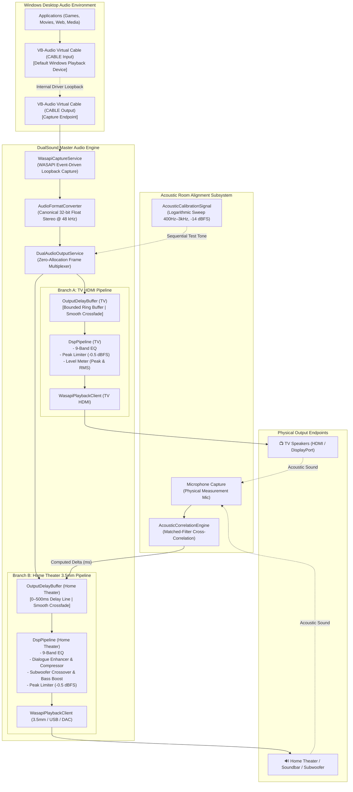

# 🎵 DualSound — Home Theater Audio Processor

<p align="center">
  <strong>Low-Latency Simultaneous Dual Audio Output, Phase Synchronization & Multi-Branch DSP Engine for Windows</strong>
</p>

<p align="center">
  
  
  
  
  
  
</p>

---

## 📖 Table of Contents

- [Overview](#-overview)
  - [The Problem: Windows Audio Limitations](#the-problem-windows-audio-limitations)
  - [The Solution: DualSound Architecture](#the-solution-dualsound-architecture)
- [Key Features](#-key-features)
- [System Architecture & Audio Pipeline](#-system-architecture--audio-pipeline)
  - [Real-Time Audio Data Flow](#real-time-audio-data-flow)
  - [Project & Solution Breakdown](#project--solution-breakdown)
- [Audio Processing & DSP Deep Dive](#-audio-processing--dsp-deep-dive)
  - [Sub-Millisecond Synchronization & Delay Lines](#1-sub-millisecond-synchronization--delay-lines)
  - [Acoustic Microphone Auto-Calibration](#2-acoustic-microphone-auto-calibration)
  - [Continuous Live Sync Drift Monitoring](#3-continuous-live-sync-drift-monitoring)
  - [Independent Branch DSP Pipelines](#4-independent-branch-dsp-pipelines)
- [Curated Sound Presets](#-curated-sound-presets)
- [First-Time Setup & Routing Guide](#-first-time-setup--routing-guide)
  - [Prerequisites](#prerequisites)
  - [Setup Wizard Walkthrough](#setup-wizard-walkthrough)
- [Building & Running from Source](#-building--running-from-source)
- [Configuration Reference (`settings.json`)](#-configuration-reference-settingsjson)
- [Troubleshooting & Windows Audio Bypasses](#-troubleshooting--windows-audio-bypasses)
- [Testing & Quality Assurance](#-testing--quality-assurance)
- [License](#-license)

---

## 🌟 Overview

**DualSound** is a high-performance Windows desktop application built with **.NET 10** and **WPF** that eliminates one of Windows' most enduring audio limitations: **the inability to route system audio across two different physical playback devices simultaneously without latency mismatch**.

Designed specifically for living rooms, gaming setups, and home theaters where a **TV (connected via HDMI / DisplayPort)** and an **External Home Theater or Soundbar (connected via 3.5mm analog, USB, or Optical)** operate together, DualSound provides real-time dual output distribution, sub-millisecond acoustic delay compensation, branch-specific audio DSP, and acoustic auto-calibration via microphone.

```
                  ┌────────────────────────────────────────────────────────┐
                  │                 Windows Desktop Audio                  │
                  │         (Games, Movies, Spotify, YouTube, etc.)        │
                  └───────────────────────────┬────────────────────────────┘
                                              │ Loopback Capture
                                              ▼
                                   ┌────────────────────┐
                                   │  DualSound Engine  │
                                   └─────────┬──────────┘
                                             │
                       ┌─────────────────────┴─────────────────────┐
                       ▼                                           ▼
      ┌─────────────────────────────────┐         ┌─────────────────────────────────┐
      │         HDMI TV Branch          │         │    Home Theater 3.5mm Branch    │
      │  Delay Buffer (0 ms)            │         │  Delay Buffer (+45 ms Sync)     │
      │  Natural Movie Master Mix       │         │  Speech Clarity + Sub Bass EQ   │
      └────────────────┬────────────────┘         └────────────────┬────────────────┘
                       │                                           │
                       ▼                                           ▼
                 [ 📺 HDMI TV ]                           [ 🔊 Home Theater ]
                       └─────────────────────┬─────────────────────┘
                                             ▼
                                Perfect Phase Alignment
                                  (Zero Echo / Combs)
```

---

### The Problem: Windows Audio Limitations

1. **Single Output Restriction**: Windows CoreAudio (WASAPI) restricts default playback to a single hardware endpoint. You cannot natively play audio through your TV speakers and external sound system concurrently.
2. **The Acoustic Latency Gap**: Modern smart TVs introduce significant digital video and audio processing latency (often **30 ms to 120 ms**). If audio is mirrored using basic splitters or standard Windows "Listen to this device" loopbacks, the analog soundbar plays instantly while the TV lags behind, creating an unbearable stadium-style echo and severe phase cancellation (comb filtering).
3. **Muddled Center Channels**: Living room setups frequently suffer from quiet dialogue buried beneath roaring movie sound effects, forcing users to constantly ride the volume control.

---

### The Solution: DualSound Architecture

DualSound captures desktop audio using a low-latency virtual audio cable bridge, canonicalizes the stream to 32-bit floating-point samples, and splits it into two isolated playback streams:
- **TV HDMI Branch**: Maintains natural reference soundtrack levels.
- **Home Theater Branch**: Applies calibrated millisecond delay to perfectly match the TV's processing pipeline, while running dedicated **Dialogue Clarity Enhancement**, **Subwoofer Crossover Filtering & Bass Boost**, and **Peak Limiting**.
- **Automated Microphone Calibration**: Emits band-limited logarithmic frequency chirps from both outputs and uses hierarchical matched-filter cross-correlation to automatically detect and align physical room acoustics down to the sub-millisecond.

---

## ✨ Key Features

| Category | Capability | Technical Highlight |
|:---|:---|:---|
| 🔀 **Simultaneous Dual Output** | Stream system audio to two devices at once | Dedicated WASAPI render clients per hardware endpoint with isolated error boundaries. |
| ⏱️ **Sub-Millisecond Sync** | Delay adjustment from 0 to 500 ms | Bounded ring buffer delay lines with smooth raised-cosine crossfade on adjustments (click- & pop-free). |
| 🎤 **Acoustic Auto-Calibration** | Automatic microphone room alignment | Logarithmic chirp sweeps (400 Hz–3 kHz) + 2-stage hierarchical matched-filter cross-correlation. |
| 🔄 **Live Drift Monitoring** | Real-time hardware clock drift correction | Continuously tracks asynchronous DAC crystal clock drift and micro-adjusts buffer offsets smoothly. |
| 🗣️ **Dialogue Clarity Enhancer** | Highlight speech & tame background roar | Speech formant peaking filter (1.5–3.5 kHz), dynamic vocal compressor (10ms attack / 120ms release), 90 Hz rumble high-pass filter. |
| 🔊 **Subwoofer Bass Processor** | Deep cinematic low-end impact | 2nd-order Butterworth crossover low-pass filter (40–300 Hz), 80 Hz low-shelf boost (up to +15 dB), and mono bass summing. |
| 🎚️ **9-Band Graphic Equalizer** | Precision frequency contouring per branch | Zero-allocation in-place biquad filters: 60, 120, 250, 500 Hz, 1, 2, 4, 8, 16 kHz (-12 dB to +12 dB). |
| 🛡️ **Studio-Grade Peak Limiter** | Anti-clipping & speaker safety guard | Enforces -0.5 dBFS ceiling, zero-latency peak catching, exponential recovery, and NaN/Inf sample sanitation. |
| 🎭 **Curated Presets** | Instant acoustic profiles | Movie Theatre, Dialogue Boost, Bass Boost, Night Mode, Balanced, and Custom. |
| 🩺 **Routing Diagnostic & Wizard** | System-wide audio routing verification | Step-by-step 7-stage First-Time Setup Wizard, Virtual Cable verification, Windows routing check, and safe test tones. |
| 🔌 **Hardware Hotplug Watchdog** | Seamless device connect/disconnect recovery | Native Windows CoreAudio `IMMNotificationClient` listener automatically recovers streams on device state changes. |
| 🎨 **Modern Dark WPF UI** | Responsive, hardware-accelerated GUI | Dark theme (`#0B0F19`), custom vector icons, real-time stereo VU peak & RMS level meters with smooth decay. |
| 🔒 **100% Offline & Private** | Zero data transmission, zero telemetry | Fully standalone; persists local settings to `%APPDATA%\DualSound\settings.json`. |

---

## 🏗️ System Architecture & Audio Pipeline

DualSound is designed around Clean Architecture and the MVVM pattern, strictly separating core audio processing contracts, low-level WASAPI hardware interfaces, and WPF UI bindings.

```
                           ┌───────────────────────────┐
                           │    DualSound.Contracts    │
                           │ Enums, Models, DTOs, Events│
                           └─────────────▲─────────────┘
                                         │
                    ┌────────────────────┴────────────────────┐
                    │                                         │
       ┌─────────────────────────┐               ┌─────────────────────────┐
       │     DualSound.Core      │               │ DualSound.Infrastructure│
       │  Interfaces & Contracts │               │  Device Discovery, JSON │
       └────────────▲────────────┘               └────────────▲────────────┘
                    │                                         │
                    ├────────────────────┬────────────────────┤
                    │                    │                    │
       ┌─────────────────────────┐       │       ┌─────────────────────────┐
       │     DualSound.Audio     │       │       │      DualSound.App      │
       │ Capture, DSP, Sync, Out │       │       │    WPF UI, ViewModels   │
       └─────────────────────────┘       │       └─────────────────────────┘
                                         ▼
                               ┌───────────────────┐
                               │  DualSound.Tests  │
                               │ 98 XUnit Tests    │
                               └───────────────────┘
```

---

### Real-Time Audio Data Flow



---

### Project & Solution Breakdown

| Project | Target | Description |
|:---|:---|:---|
| **`DualSound.Contracts`** | `.NET 10.0` | Pure definitions: enums (`AudioEngineState`, `AudioOutputBranch`, `AudioPresetType`), models (`AppSettings`, `OutputBranchSettings`, `AudioLevels`), and events. Zero third-party dependencies. |
| **`DualSound.Core`** | `.NET 10.0` | Clean service abstractions (`IAudioEngineService`, `IDualAudioOutputService`, `IAcousticCalibrationService`, `ISystemAudioRoutingService`, `IAudioSyncManager`), and MVVM base classes. |
| **`DualSound.Audio`** | `.NET 10.0-windows` | Core audio implementation: WASAPI loopback capture, RBJ biquad DSP filters, 9-band EQ, speech compressor, bass crossover, delay buffers, NAudio hardware integration, and acoustic correlation engine. |
| **`DualSound.Infrastructure`** | `.NET 10.0-windows` | Concrete infrastructure: `JsonSettingsService` (atomic local persistence), `WindowsAudioDeviceDiscoveryService`, and `WindowsAudioDeviceMonitorService` (`IMMNotificationClient`). |
| **`DualSound.App`** | `.NET 10.0-windows` | Modern WPF desktop application: MVVM architecture, CommunityToolkit.Mvvm, Microsoft.Extensions.Hosting, custom vector icons, and real-time VU level metering controls. |
| **`DualSound.Tests`** | `.NET 10.0-windows` | 98 automated unit and integration tests covering filters, buffers, cross-correlation, device monitors, and viewmodel lifecycles. |

---

## 🔬 Audio Processing & DSP Deep Dive

### 1. Sub-Millisecond Synchronization & Delay Lines
Modern televisions apply post-processing (frame interpolation, upscaling, Dolby audio decoding) that delays sound output by **30 ms to 120 ms**. If an external analog soundbar receives the signal simultaneously, it fires early, resulting in distracting echo and severe phase cancellation.

- **Bounded Delay Line (`OutputDelayBuffer`)**: Pre-allocated circular ring buffer holding up to 1000 ms of interleaved stereo 32-bit floating-point audio.
- **Raised-Cosine Crossfading**: Adjusting delay during active playback does **not** cause audible clicks, pops, or audio discontinuities. When a new delay is set, the buffer calculates a 256-sample (~5.3 ms) raised-cosine crossfade between the old and new read pointers:
  $$\text{envelope}(i) = \frac{1}{2} \left(1 - \cos\left(\frac{\pi \cdot i}{N}\right)\right)$$
- **Granular Control**: Supports $\pm 1\text{ ms}$ precision micro-stepping as well as coarse $\pm 5\text{ ms}$ and $\pm 20\text{ ms}$ adjustments.

---

### 2. Acoustic Microphone Auto-Calibration
DualSound includes an acoustic measurement engine that automatically computes the exact time-of-flight delta between your TV and Home Theater using any standard USB or 3.5mm microphone.

```
       [ TV Output ]           ─── Chirp Sweep ───►  \
                                                       [ 🎙️ Microphone ]  ──► Cross-Correlation  ──►  Exact Offset
       [ Home Theater Output ] ─── Chirp Sweep ───►  /
```

1. **Band-Limited Logarithmic Chirp**: Generates a 200 ms logarithmic sweep from 400 Hz to 3,000 Hz with a 15 ms raised-cosine entry/exit window and a safe $-14\text{ dBFS}$ hardware ceiling:
   $$f(t) = f_0 \cdot \left(\frac{f_1}{f_0}\right)^{t / T}$$
2. **Two-Stage Hierarchical Cross-Correlation (`AcousticCorrelationEngine`)**:
   - **Stage 1 (Coarse)**: Decimated search across the captured buffer to locate the region of arrival.
   - **Stage 2 (Fine)**: Sample-accurate full-resolution cross-correlation:
     $$R_{xy}(\tau) = \sum_{n} x[n] \cdot y[n + \tau]$$
3. **Signal Quality Validation**: Computes peak-to-noise ratio (PNR). Requires $\text{PNR} \ge 3.5\text{x}$ for validity and $\text{PNR} \ge 6.0\text{x}$ for high confidence.
4. **Automated Application**: Subtracts TV arrival time from Home Theater arrival time to compute the exact millisecond offset and applies it directly to the Home Theater delay line.

---

### 3. Continuous Live Sync Drift Monitoring
Even when two audio devices are synchronized at startup, asynchronous hardware clock crystals (e.g. Realtek onboard DAC vs. Nvidia/AMD HDMI audio clock) run at micro-variations of 48,000 Hz. Over several hours, this causes audio drift.

DualSound's `LiveSyncMonitoringService` tracks buffer consumption rates, calculates cumulative drift samples, and applies smooth, click-free sample drops/insertions when timing drift crosses the user-defined tolerance threshold (default: $2.0\text{ ms}$).

---

### 4. Independent Branch DSP Pipelines

Each output branch contains a zero-allocation, in-place real-time DSP pipeline:

#### A. 9-Band Graphic Equalizer (`NineBandEqualizer`)
Implements 9 Robert Bristow-Johnson (RBJ) Audio EQ Cookbook peaking biquad filters:
- **Center Frequencies**: $60\text{ Hz}, 120\text{ Hz}, 250\text{ Hz}, 500\text{ Hz}, 1\text{ kHz}, 2\text{ kHz}, 4\text{ kHz}, 8\text{ kHz}, 16\text{ kHz}$.
- **Gain Range**: $-12.0\text{ dB}$ to $+12.0\text{ dB}$ ($Q = 1.414$ for 1-octave bandwidth).

#### B. Dialogue Clarity Enhancer (`DialogueEnhancer`)
Tailored for center channel and speech intelligibility:
- **Speech Formant Filter**: Peaking biquad centered at $2,500\text{ Hz}$ ($Q = 1.2$) boosting vocal presence up to $+12\text{ dB}$.
- **Rumble Filter**: 2nd-order high-pass filter at $90\text{ Hz}$ to prevent low-end movie effects from modulating dialogue.
- **Dynamic Vocal Compressor**: Leveler with fast attack ($10\text{ ms}$) and smooth release ($120\text{ ms}$) to make whispers intelligible while clamping deafening shouts.

#### C. Subwoofer Bass Processor (`BassProcessor`)
Optimized for home theater subwoofers and analog 2.1 systems:
- **2nd-Order Butterworth Low-Pass Crossover**: Variable $40\text{ Hz}$ to $300\text{ Hz}$ ($Q = 0.707$) to filter out high frequencies.
- **Parametric Low-Shelf Boost**: Centered at $80\text{ Hz}$ with up to $+15\text{ dB}$ gain.
- **Mono Bass Summing**: Mixes left and right low frequencies to mono for consistent dual-subwoofer acoustic dispersion:
  $$\text{MonoSample} = 0.5 \cdot (\text{Left} + \text{Right})$$

#### D. Studio-Grade Peak Limiter (`PeakLimiter`)
Enforces safe listening thresholds and protects physical speakers:
- **Ceiling**: Clamped at $-0.5\text{ dBFS}$ ($0.944f$ linear).
- **Zero Attack / Exponential Release**: Catches transients instantaneously with smooth exponential recovery.
- **Sanitation**: Detects and eliminates `float.NaN` and `float.PositiveInfinity`/`NegativeInfinity` artifacts, replacing them with clean silence ($0.0f$).

---

## 🎭 Curated Sound Presets

DualSound includes 6 purpose-built audio profiles accessible via the Dashboard or Equalizer view:

```
┌─────────────────┬───────────────────────────────────┬───────────────────────────────────┐
│ Preset          │ TV HDMI Branch (Highs & Imaging)  │ Home Theater Branch (Center & Sub)│
├─────────────────┼───────────────────────────────────┼───────────────────────────────────┤
│ 🎬 Movie        │ Flat 0 dB EQ, Natural Ambience,   │ +5.5 dB Bass @ 110 Hz (Mono Sub), │
│    Theatre      │ Dialogue & Bass bypass            │ +3.5 dB Vocal Boost @ 2.5 kHz     │
├─────────────────┼───────────────────────────────────┼───────────────────────────────────┤
│ 🗣️ Dialogue     │ Volume -1.5 dB, Clean Sound,      │ +6.5 dB Vocal Boost, 2.8:1 Comp,  │
│    Boost        │ Dialogue & Bass bypass            │ Highs/Mids accented for speech    │
├─────────────────┼───────────────────────────────────┼───────────────────────────────────┤
│ 💥 Bass         │ Volume -0.5 dB, Clean Sound,      │ +8.5 dB Bass @ 135 Hz (Mono Sub), │
│    Boost        │ Dialogue & Bass bypass            │ +7 dB @ 60 Hz, +6 dB @ 120 Hz     │
├─────────────────┼───────────────────────────────────┼───────────────────────────────────┤
│ 🌙 Night        │ Volume -3.0 dB, -6 dB @ 60 Hz,    │ -6 dB Sub Bass, 3.2:1 Comp,       │
│    Mode         │ Heavy dynamic range compression   │ High dynamic range suppression    │
├─────────────────┼───────────────────────────────────┼───────────────────────────────────┤
│ ⚖️ Balanced     │ Flat 0 dB EQ, 100% Volume,        │ Flat 0 dB EQ, 100% Volume,        │
│                 │ Reference uncolored response      │ Reference uncolored response      │
├─────────────────┼───────────────────────────────────┼───────────────────────────────────┤
│ ⚙️ Custom       │ Fully user-configurable           │ Fully user-configurable           │
└─────────────────┴───────────────────────────────────┴───────────────────────────────────┘
```

---

## 🚀 First-Time Setup & Routing Guide

### Prerequisites

1. **Windows 10 or 11 (64-bit)**.
2. **.NET 10.0 Runtime** (or .NET 10.0 SDK for building from source).
3. **Virtual Audio Cable**:
   - DualSound requires a virtual audio loopback driver to capture desktop audio without invasive kernel hooks.
   - We recommend the free **[VB-Audio Virtual Cable](https://vb-audio.com/Cable/)** (`CABLE-A` / `CABLE-B` or standard `VB-CABLE`).
   - *How it works*: Windows outputs audio to **CABLE Input**, and DualSound reads from **CABLE Output** to distribute to both physical outputs.

---

### Setup Wizard Walkthrough

When DualSound is launched for the first time, the **7-Step Setup Wizard** automatically guides you through configuration:

```
[ Step 1: Welcome & Virtual Cable Check ]
         │
         ▼
[ Step 2: Audio Source Detection (CABLE Input / Output Pairing) ]
         │
         ▼
[ Step 3: Windows Default Playback Device Verification ]
         │
         ▼
[ Step 4: Physical Output Selection (TV HDMI vs Home Theater 3.5mm) ]
         │
         ▼
[ Step 5: Hardware Capability & Buffer Latency Probe ]
         │
         ▼
[ Step 6: Safe Acoustic Test Tone (440 Hz Soft Sine Verification) ]
         │
         ▼
[ Step 7: Completion & Launch Dashboard ]
```

#### Step-by-Step Instructions:
1. **Install VB-Audio Virtual Cable**:
   - Download and extract VB-Audio Cable.
   - Right-click `VBCABLE_Setup_x64.exe` and select **Run as Administrator**. Click **Install Driver**.
2. **Set Windows Default Output**:
   - Open **Windows Settings > System > Sound**.
   - Under **Choose where to play sound**, select **CABLE Input (VB-Audio Virtual Cable)**.
3. **Launch DualSound**:
   - DualSound will detect the virtual cable and confirm the Windows routing configuration.
4. **Assign Hardware Endpoints**:
   - **TV Output**: Select your TV's HDMI or DisplayPort connection.
   - **Home Theater Output**: Select your external speakers, 3.5mm Realtek Audio Out, or USB DAC.
5. **Verify with Safe Test Tone**:
   - Press **Play Test Tone** in the Setup Wizard or Audio Routing tab. You will hear a gentle 440 Hz test tone through both outputs.
6. **Synchronize Audio**:
   - Navigate to **Manual Sync** to adjust delay sliders, or navigate to **Auto Calibration** with your microphone to let DualSound automatically compute and apply the exact acoustic delay.

---

## 💻 Building & Running from Source

### Prerequisites
- [.NET 10.0 SDK](https://dotnet.microsoft.com/download/dotnet/10.0)
- Windows PowerShell 5.1+ or PowerShell 7+
- Visual Studio 2022+ / Visual Studio Code / JetBrains Rider

### Clone & Build
```powershell
# 1. Clone the repository
git clone https://github.com/your-username/Home-Theater.git
cd Home-Theater

# 2. Ensure .NET 10 is in your environment PATH
$env:PATH = "$env:USERPROFILE\.dotnet;" + $env:PATH

# 3. Restore dependencies
dotnet restore DualSound.sln

# 4. Build solution in Release configuration
dotnet build DualSound.sln --configuration Release
```

### Run Application
```powershell
# Run the WPF Application
dotnet run --project src/DualSound.App/DualSound.App.csproj
```

---

## ⚙️ Configuration Reference (`settings.json`)

DualSound persists all configuration locally in valid JSON format at:
```
%APPDATA%\DualSound\settings.json
```
*(e.g., `C:\Users\<Username>\AppData\Roaming\DualSound\settings.json`)*

### Sample Configuration
```json
{
  "Theme": "Dark",
  "AutoRefreshDevices": true,
  "RefreshIntervalSeconds": 5,
  "ShowDisconnectedDevices": true,
  "ShowDisabledDevices": true,
  "PreferredPrimaryDeviceId": "{0.0.0.00000000}.{a1b2c3d4-tv-hdmi}",
  "PreferredSecondaryDeviceId": "{0.0.0.00000000}.{e5f6g7h8-35mm-speakers}",
  "PreferredCaptureDeviceId": "{0.0.1.00000000}.{i9j0k1l2-cable-output}",
  "ActivePreset": "MovieTheatre",
  "AutoStartEngine": false,
  "StartMinimized": false,
  "TargetSampleRate": 48000,
  "BufferLatencyMs": 50,
  "AutoRestartOnDeviceLoss": true,
  "IsSetupWizardCompleted": true,
  "RestoreDefaultDeviceOnExit": false,
  "ShowRoutingWarningBanner": true,
  "IsLiveSyncMonitoringEnabled": true,
  "LiveSyncToleranceMs": 2.0,
  "SelectedCalibrationMicrophoneId": "{0.0.1.00000000}.{mic-id}",
  "LastCalibrationConfidence": 0.94,
  "LastMeasuredDifferenceMs": 42.5
}
```

> [!NOTE]
> DualSound employs atomic file writes (`settings.json.tmp` followed by atomic replacement) and creates automatic fallback backups (`settings.json.bak`) to prevent corruption during unexpected shutdowns.

---

## 🛠️ Troubleshooting & Windows Audio Bypasses

### 1. "Virtual Audio Cable Not Found"
- **Cause**: VB-Audio Cable is not installed or the driver has not started.
- **Solution**: Install VB-Audio Cable as Administrator and restart Windows. Ensure **CABLE Input** appears in Windows Sound Playback devices and **CABLE Output** appears in Recording devices.

### 2. Audio is Only Playing Through One Device
- **Check 1**: In the **Dashboard**, verify the Master Audio Engine is **Running**.
- **Check 2**: Ensure neither branch has its **Mute** button toggled on.
- **Check 3**: In **Audio Routing**, ensure Windows default playback is set to **CABLE Input**.

### 3. Applications Bypassing DualSound
DualSound's diagnostic engine monitors for known Windows audio bypass conditions:
- **Per-App Audio Routing**: If an application (e.g. Chrome, Discord, or VLC) has a custom output assigned in Windows Settings (*Settings > Sound > Volume mixer*), it routes directly to that hardware, bypassing the virtual cable. **Fix**: Reset the application's output to "Default".
- **WASAPI Exclusive Mode / ASIO**: Pro audio DAWs or media players using Exclusive Mode take full control of a physical DAC, bypassing the Windows mixer. **Fix**: Set the player (e.g. Foobar2000, Tidal) to *Shared Mode*.
- **DRM Protected Content**: Certain streaming applications with hardware DRM (e.g. Netflix Windows App) restrict loopback recording. **Fix**: Play via browser (Edge/Chrome) or standard stereo output.

### 4. TV Audio Echo / Comb Filtering
- In **Manual Sync**, increase or decrease the **Home Theater Delay** slider until speech from an on-screen speaker sounds crisp, centered, and coherent.
- Or use **Auto Calibration** with your microphone to calculate the exact millisecond delay automatically.

---

## 🧪 Testing & Quality Assurance

DualSound has a comprehensive automated test suite built with **xUnit** covering unit logic, signal math, buffer safety, and integration flows:

```powershell
# Run the complete test suite
dotnet test DualSound.sln
```

### Test Coverage Highlights (98 Tests)
- **Acoustic Calibration**: Verifies chirp generation, cosine ramps, SNR calculations, decimation, and peak detection across noise floors.
- **DSP Filter Tests**: RBJ biquad coefficient calculations, high-pass cutoff frequencies, 9-band peaking filters, and compressor attack/release dynamics.
- **Output Delay Buffer Tests**: Bounded ring buffer writes/reads, smooth crossfading without clicks, underrun/overrun counter assertions, and millisecond-to-sample conversions.
- **Routing & Diagnostics**: Verifies device conflict detection, virtual cable pairing, safe test tone ceiling (never exceeding safe listening limits), and error handling.
- **Hotplug Monitor**: Functional tests for Windows CoreAudio `IMMNotificationClient` callbacks and graceful stream recovery.

---

## 📄 License

This project is licensed under the [MIT License](LICENSE) — see the LICENSE file for details.

---

<p align="center">
  Crafted with precision for home theater enthusiasts, audiophiles, and living room cinema setups. 🍿🔊
</p>
